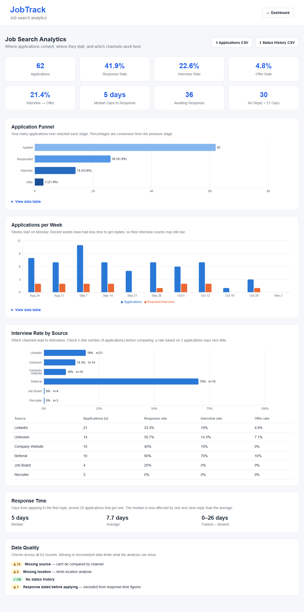
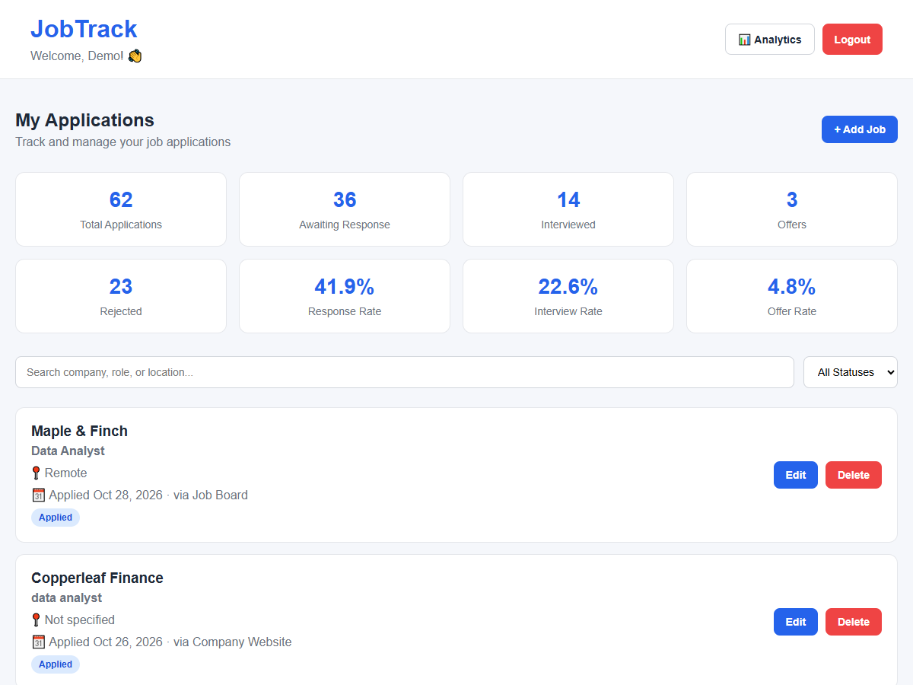
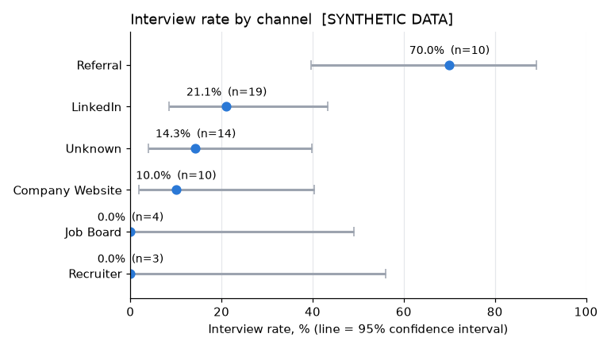
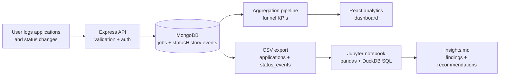

# JobTrack: Job Search Funnel Analytics

A full-stack app for tracking job applications, built around one analytics question:
**where in a job search do applications get lost, which channels lead to interviews,
and how long is it worth waiting for a reply?**

It records every status change as an event, calculates funnel KPIs in the database,
shows them on an analytics dashboard, and exports tidy data for a Python + SQL analysis
that validates the app's numbers independently.

**Live demo:** [job-track-iota-five.vercel.app](https://job-track-iota-five.vercel.app)
(register with any email to try it)

> **Project status.** The app, the analytics, the export and the analysis pipeline are
> complete and tested. Collecting real job-search data started in November 2026; findings
> will go in [`analysis/insights.md`](analysis/insights.md) once there is enough data to
> support them. **All screenshots and charts below use clearly labelled synthetic data**:
> they show what the tool does, not results.

---

## Contents

- [The analytics problem](#the-analytics-problem)
- [What it does](#what-it-does)
- [Screenshots](#screenshots-synthetic-demo-data)
- [How it works](#how-it-works)
- [Metric definitions](#metric-definitions)
- [Analysis: Python and SQL](#analysis-python-and-sql)
- [How the numbers are validated](#how-the-numbers-are-validated)
- [Limitations](#limitations)
- [Running it locally](#running-it-locally)
- [Project structure](#project-structure)

---

## The analytics problem

A job search behaves like a sales funnel: **Applied → Got a reply → Interview → Offer**.
Most trackers only store each application's *current* status, which makes the funnel
impossible to measure correctly.

The first version of this app had exactly that flaw. When an application moved from
*Interview* to *Offer* (or *Rejected*), it stopped counting as an interview, so **the
interview rate got worse as the search went better**. Fixing that meant changing the data
model, not the formula: every status change is now stored as a timestamped event, and
the KPIs count applications that **ever reached** each stage.

## What it does

| Part | What it shows |
|---|---|
| **Tracker** | Add, edit and search applications with company, role, location, **source** (LinkedIn, referral, …) and **date applied**. Every status change is recorded. |
| **Analytics dashboard** | Funnel with stage-to-stage conversion, response / interview / offer rates, median days to first reply, weekly volume, interview rate by channel with sample sizes, stale applications, and data-quality checks. Small-sample warning under 30 applications. |
| **CSV export** | Two tidy tables (applications, status events) linked by `job_id`, Excel-safe, documented in a [data dictionary](docs/data-dictionary.md). |
| **Analysis notebook** | Data-quality checks, cleaning, feature engineering, KPIs, confidence intervals, a hypothesis test, response-time percentiles, and the same KPIs in SQL. |

## Screenshots (synthetic demo data)

**Analytics dashboard:** funnel, weekly trend, channels with sample sizes, response time, data quality



**Tracker**



**From the notebook:** interview rate by channel with 95% confidence intervals



## How it works



**Data model.** One document per application, with its full status history embedded:

```js
{
  company, role, location, source,          // descriptive fields for segmentation
  status: "Offer",                          // current stage
  dateApplied: 2026-10-05,
  statusHistory: [                          // every stage it has been in
    { status: "Applied",   changedAt: 2026-10-05 },
    { status: "Interview", changedAt: 2026-10-10T10:00Z },
    { status: "Offer",     changedAt: 2026-10-20T09:30Z }
  ]
}
```

**KPI calculation** happens in a MongoDB aggregation pipeline
([`analyticsService.js`](backend/services/analyticsService.js)), commented in SQL terms:
`$match` = `WHERE`, `$group` with conditional sums = `GROUP BY … SUM(CASE WHEN …)`,
`$facet` = several grouped queries in one round trip.

**Stack:** React 19, React Router, Axios, Vite, Recharts · Node.js, Express 5, Mongoose 9,
JWT authentication with bcrypt password hashing · MongoDB Atlas · Python 3.13, pandas, DuckDB,
SciPy, matplotlib, Jupyter.

**Deployment:** frontend on Vercel, API on Render, database on MongoDB Atlas.

## Metric definitions

Full definitions, edge cases and known limitations: [`docs/metrics.md`](docs/metrics.md).

| Metric | Definition |
|---|---|
| Response rate | Applications that ever moved past *Applied* (rejections count as replies) ÷ all applications |
| Interview rate | Applications that ever reached *Interview* or *Offer* ÷ all applications |
| Offer rate | Applications that ever reached *Offer* ÷ all applications |
| Stage conversion | Each funnel stage ÷ the stage before it |
| Days to first reply | Calendar days from applying to the first status change (median, average, range) |
| Stale | Still *Applied* after 21 days |

Design decisions worth noting:

- **"No data" is not "0%".** A rate with a zero denominator is shown as "—".
- **Timezones:** application dates are calendar dates and events are exact moments, so a
  same-day reply in IST can compute as −1 day in UTC. It is treated as 0.
- **Impossible dates** (a reply before the application) are excluded from response-time
  figures and counted as a data-quality issue rather than silently included.

## Analysis: Python and SQL

[`analysis/job_search_analysis.ipynb`](analysis/job_search_analysis.ipynb) works on the CSV
export (or on synthetic practice data when no export is present, with a banner saying so):

1. **Data quality:** 13 checks, including duplicate entries, the same company spelled
   several ways, missing values, broken links between tables, impossible dates.
2. **Cleaning:** rules decided up front and logged with the number of rows each one changed;
   the raw data is never modified.
3. **Feature engineering:** status events → one row per application with funnel flags.
4. **KPIs:** recalculated with the app's definitions, raw vs cleaned side by side (shows
   how much duplicates distort the totals).
5. **Funnel, weekly trend, channels:** weekly comparisons only use applications old enough
   to have had a fair chance of a reply (cohort maturity).
6. **Uncertainty:** Wilson 95% confidence intervals for each channel's interview rate, and
   a Fisher's exact test for one hypothesis chosen in advance (referrals vs other channels).
7. **Response time:** median and 90th percentile, which gives a practical follow-up rule.
8. **SQL (DuckDB):** `GROUP BY`, `LEFT JOIN` vs inner join, CTEs, `FILTER`, a window
   function for a running total.

The synthetic data generator ([`generate_synthetic_data.py`](analysis/generate_synthetic_data.py))
plants realistic problems (duplicates, inconsistent spellings, timezone edge cases, an impossible
date) so the cleaning steps have real work to do. Patterns in synthetic data are programmed in
and are never reported as findings.

## How the numbers are validated

The KPIs are implemented **three independent ways**, and they agree:

| Implementation | Where |
|---|---|
| MongoDB aggregation pipeline | the app (`backend/services/analyticsService.js`) |
| pandas | notebook §6, using the app's exact definitions and rounding |
| SQL (DuckDB) | notebook §11; the notebook stops with an error if SQL and pandas disagree |

On the synthetic dataset, loading the same CSVs into the app and comparing gives identical
results on all 13 compared KPIs, including the timezone rule, the excluded impossible date and the rounding.

**Backend tests:** 68 automated tests (`npm test`) against a temporary in-memory database,
covering validation, access control between users, the funnel definitions on a hand-calculated
dataset, CSV escaping and encoding, error handling, CORS and rate limiting. Re-introducing the
original interview-rate bug makes 4 of them fail.

## Limitations

- **Sample size.** One person's job search is tens of applications, not thousands. Channel
  comparisons are directional; the dashboard and notebook say so and show sample sizes.
- **Recent applications haven't had time to get a reply**, so recent rates look worse than
  they will end up.
- **Dates are when changes were logged**, which can be later than when a company replied.
- **Records created before status tracking** have approximate history (a backfill script
  dates their last change at the record's last update).

## Running it locally

Requires Node.js 22+, Python 3.11+ (for the analysis) and a MongoDB connection string (e.g. a free MongoDB Atlas cluster).
Use a **separate database for development** so test entries don't mix with real data.

```bash
# API (http://localhost:5000)
cd backend
cp .env.example .env        # then fill in MONGO_URI and JWT_SECRET
npm install
npm run dev

# Web app (http://localhost:5173)
cd frontend
npm install
npm run dev
```

Analysis (see [`analysis/README.md`](analysis/README.md) for details and a learning path):

```bash
cd analysis
python -m venv .venv
.venv\Scripts\Activate.ps1           # macOS/Linux: source .venv/bin/activate
pip install -r requirements.txt
jupyter notebook job_search_analysis.ipynb
```

Tests: `cd backend && npm test` (downloads a MongoDB binary for the in-memory server on first run).

### Configuration

| Variable | Where | Purpose |
|---|---|---|
| `MONGO_URI` | backend, required | MongoDB connection string |
| `JWT_SECRET` | backend, required | Secret for signing login tokens |
| `CORS_ORIGINS` | backend, recommended | Comma-separated frontend URLs allowed to call the API |
| `AUTH_RATE_LIMIT` | backend, optional | Login/register attempts per IP per 15 minutes (default 20) |
| `TRUST_PROXY` | backend, optional | Proxies in front of the API (default 1, e.g. Render) |
| `VITE_API_URL` | frontend | API base URL (set in `.env.development` / `.env.production`) |

For the deployed setup, set `CORS_ORIGINS=https://job-track-iota-five.vercel.app` on Render.

One-time migration for data created before status history existed:
`npm run backfill:history` (dry run), then `npm run backfill:history -- --apply`.

## Project structure

```
backend/
  app.js, server.js           Express app; startup (config check, DB connection)
  models/                     User, Job (with statusHistory events)
  controllers/, routes/       auth, jobs, analytics, CSV export
  services/                   analyticsService (KPI pipeline), exportService (CSV)
  scripts/                    backfillStatusHistory (one-time migration)
  tests/                      node:test + supertest + in-memory MongoDB
frontend/
  src/pages/                  Dashboard, Analytics, Add/Edit job, Login, Register, 404
  src/components/JobForm.jsx  shared add/edit form
  src/api.js, src/auth.js     API client (token, expired sessions), session helpers
analysis/
  job_search_analysis.ipynb   the analysis
  generate_synthetic_data.py  practice data in the export format
  insights.md                 write-up template (filled in from real data only)
docs/
  metrics.md                  KPI definitions and limitations
  data-dictionary.md          export columns and how the tables link
```
