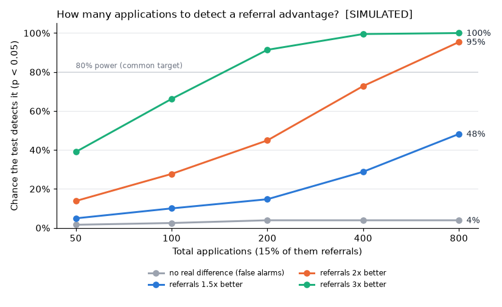

# Method evaluation (synthetic data)

> **Everything here is simulated.** It measures how well the notebook's *methods*
> work when the true answer is known. It says nothing about real job searches.
> Regenerate with `python evaluate_methods.py` (1,000 simulated searches per setting,
> fixed seeds, so the numbers are reproducible).

## The known truth

From the generator's parameters (`generate_synthetic_data.py`), the *eventual* rates,
if every application had unlimited time to get a reply:

| Quantity | True value |
|---|---|
| Reply rate, all channels | 46.8% |
| Interview rate, all channels | 17.6% |
| Interview rate, referrals | 48.0% |
| Interview rate, other channels | 13.5% |
| Share of applications that are referrals | 12% |

## 1. Sampling noise: one search is a small sample

Across 1,000 simulated searches of **60 applications** each, all with the same true
interview rate of **17.6%**:

| Interview rate measured on | Average | Middle 90% of searches | Median |
|---|---|---|---|
| All applications | 16.7% | 8.3% – 25.0% | 16.7% |
| Mature applications only (21+ days old) | 17.5% | 8.9% – 27.7% | 17.0% |

**Reading it:** two people with *identical* true chances can see interview rates of
8% and 25% just by luck. A single rate from tens of applications
needs its confidence interval next to it.

## 2. Recency bias: recent applications drag the rate down

Counting every application gives an average of **16.7%** against a truth of
**17.6%**: it understates the rate by
**0.9 percentage points**, because the newest
applications haven't had time to get a reply. Using only mature applications
(the notebook's rule) gives **17.5%**, closing
90% of the gap. The rest comes
from replies that take longer than 21 days.

The bias is small here because only **23%** of these synthetic applications
are under 21 days old. In an active search, where most applications are recent, it is much
larger, which is why the notebook's weekly comparison uses mature weeks only.

## 3. Do the 95% confidence intervals contain the truth?

Wilson intervals on mature applications. A well-calibrated 95% interval should
contain the true value in about 95% of searches.

| Applications | Coverage: overall interview rate | Avg. width | Coverage: referral interview rate | Avg. width | Searches with < 5 mature referrals |
|---|---|---|---|---|---|
| 30 | 95.4% | 30% | 97.8% | 70% | 86% |
| 60 | 95.2% | 21% | 95.7% | 61% | 34% |
| 120 | 95.3% | 15% | 94.4% | 50% | 2% |
| 240 | 95.2% | 11% | 95.1% | 38% | 0% |

**Reading it:** All coverages are between 94.4% and 97.8%. With 1,000 simulations, random noise alone moves a coverage estimate by about ±1.4 points, so the intervals are **well calibrated**: a 95% interval really does contain the truth about 95% of the time. With very few referrals the interval is slightly conservative (wider than strictly needed). The widths show how little a small sample pins down:
with 60 applications, the referral interval is typically
61% wide.

## 4. How many applications are needed to detect a channel difference?

### The large effect planted in the practice data

Referrals are set to convert at 48% vs
13% for other channels, a very large (about
3.6x) difference. Fisher's exact test on mature applications:

| Applications | Typical number of mature referrals | Chance of detecting it (p < 0.05) |
|---|---|---|
| 30 | 3 | 17% |
| 60 | 5 | 38% |
| 120 | 11 | 67% |
| 240 | 22 | 94% |

### Planning for realistic, smaller effects

Simple model: other channels convert at 15%, and
15% of applications are referrals.

| Referral advantage | 50 apps | 100 apps | 200 apps | 400 apps | 800 apps |
|---|---|---|---|---|---|
| none (false-alarm rate) | 2% | 2% | 4% | 4% | 4% |
| 1.5x | 5% | 10% | 15% | 29% | 48% |
| 2.0x | 14% | 28% | 45% | 73% | 95% |
| 3.0x | 39% | 66% | 91% | 100% | 100% |

- To detect a **2x** referral advantage 80% of the time takes **between 400 and 800 applications**;
  a **1.5x** advantage takes **more than 800**; a **3x** advantage **between 100 and 200**.
- When there is **no real difference**, the test raised a false alarm in at most
  **3.9%** of searches, at or below the intended 5%. Fisher's exact test is
  conservative, so false alarms are not the main risk; **missing a real difference is**.

## What this means for analysing a real job search

1. **Report rates with confidence intervals and sample sizes**, never alone.
2. **Compare channels on mature applications** (21+ days old), or recent weeks will look worse than they are.
3. **A non-significant test early in a search means "not enough data yet"**, not "no difference".
   With realistic effect sizes, expect to need a few hundred applications before a channel
   comparison can be conclusive; until then, treat differences as directional.
4. **Decide the comparison before looking** (as the notebook does with referrals vs the rest);
   testing every channel against every other would raise the false-alarm rate.
